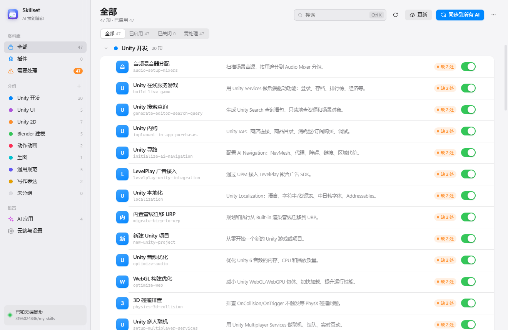
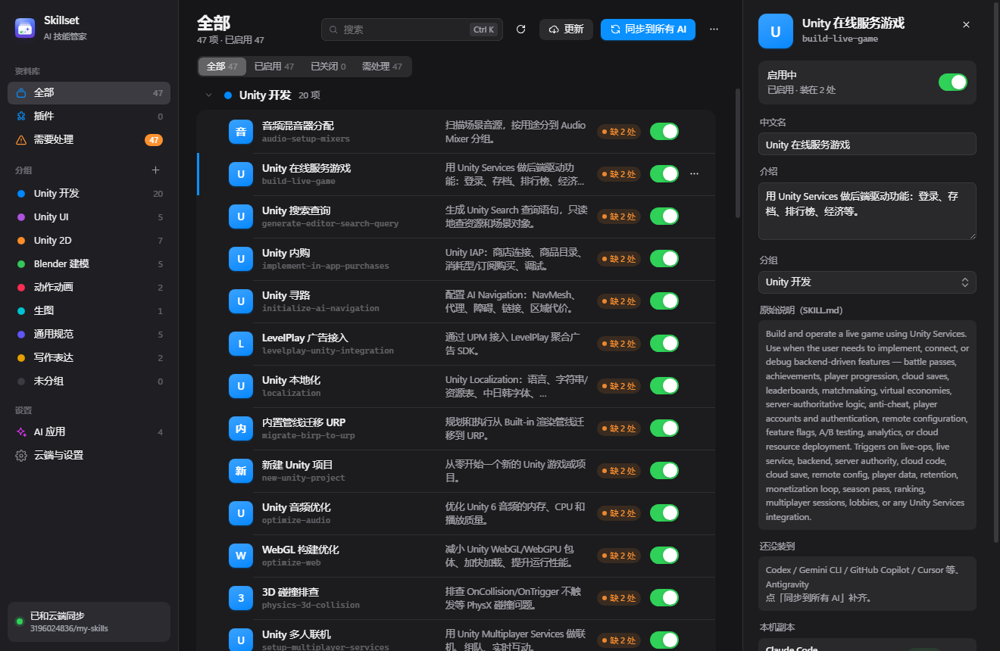
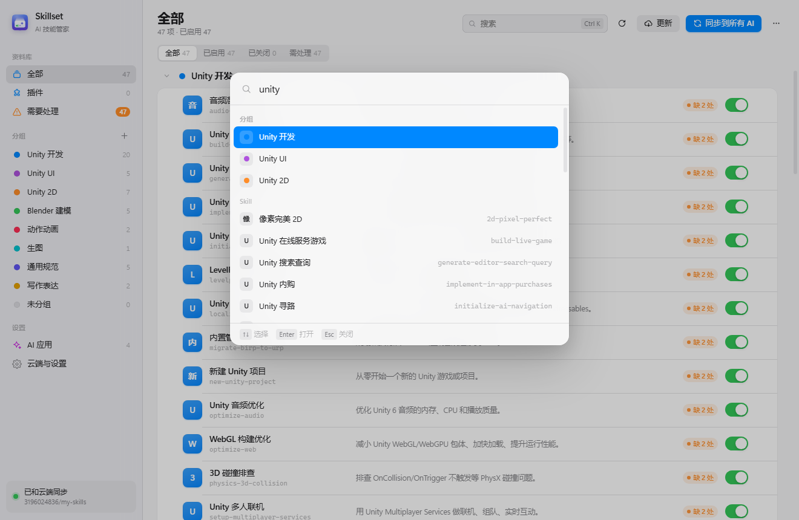

<p align="center">
  
</p>

<h1 align="center">Skillset</h1>

<p align="center">
  一个地方管理所有 AI 的 skill 和插件 · 一键装到 Claude Code、Codex、Gemini、Cursor 等 31 款 AI<br>
  <sub>One place to manage Agent Skills & Claude Code plugins, synced to every AI you use, backed by your own GitHub.</sub>
</p>

<p align="center">
  
</p>

## 能做什么

- **一张清单看全部**：自动扫描本机所有 AI 的 skill（`SKILL.md` 文件夹），每条都有中文名、介绍、英文名和状态。
- **开关即装卸**：关闭 = 从电脑上删除（云端保留），启用 = 从云端装回。云端没备份、或本机有改动时，一定先问你。
- **一键装到所有 AI**：Claude Code、Codex、Gemini CLI、Cursor、Copilot、Windsurf、OpenCode、Antigravity 等，共支持 31 款 AI。
- **分组**：自建「生图」「Unity 开发」之类的分组，skill 和插件都能放进去，整组开关；把条目拖到左侧分组即可归类。
- **Claude Code 插件**：安装、卸载、浏览市场，插件里包含的 skill 展开可见。
- **云端 = 你自己的 GitHub 私有仓库**：上传、更新、删除；换新电脑连上同一个仓库，一键全部装回。
- **上传前查密钥**：发现 API key、token、私钥就拦下，不会推到云端。

<p align="center">
  
  
</p>

## 开始使用

需要 **Python 3.12+** 和 **git**，不用装任何 Python 依赖。推荐装 [GitHub CLI](https://cli.github.com/)，可以一键登录并建私有仓库。

```bash
git clone https://github.com/3196024836/skillset.git
cd skillset
```

| 系统 | 启动方式 |
| --- | --- |
| Windows | 双击 `start.bat`；或运行 `python app\server.py --install-shortcut` 在桌面创建带图标、无黑窗的快捷方式 |
| macOS / Linux | `./start.sh` |

界面会以独立窗口打开（使用本机的 Edge / Chrome，找不到时用默认浏览器）。关掉窗口程序就退出。

第一次打开会有引导：

1. **连接云端**：已登录 GitHub CLI 就一键新建私有仓库 `my-skills`；换新电脑时填之前的仓库地址，会自动下载。也可以先跳过，只在本机用。
2. **选择 AI**：勾选要安装到哪些 AI（默认勾选本机检测到的）。
3. 点 **同步到所有 AI**，完成。

## 快捷键

| 按键 | 作用 |
| --- | --- |
| `Ctrl K` | 命令面板：搜条目、跳转、执行操作 |
| `Ctrl F` / `/` | 搜索 |
| `↑` `↓` / `Enter` | 在列表中移动 / 打开详情 |
| `空格` | 启用或关闭 |
| `Delete` | 彻底删除（会确认） |
| `Ctrl A` / `Ctrl` 点击 / `Shift` 点击 | 多选，底部出现批量操作条 |
| `Esc` | 关闭面板、取消选择 |
| 右键 | 条目和分组的快捷菜单 |

## 原理

```
你的 GitHub 私有仓库  ⇄  本机库 library/（git：manifest.json + skills/<名字>/）
                                │  启用 = 复制过去，关闭 = 删掉
          ┌─────────────────────┼──────────────────────┐
   ~/.claude/skills      ~/.agents/skills          各 AI 自己的目录
   (Claude Code)    (Codex、Gemini CLI、Cursor、     (Antigravity 等)
                     Copilot 等十几个 AI 共用)
```

- **库是正本**：skill 原件和 `manifest.json`（中文名、介绍、分组、启用状态、插件和市场来源）放在单独的 git 仓库里。
- **AI 目录里放副本**：通过内容哈希判断每个副本「一致 / 有改动 / 仅本机」。
- **插件**：只通过官方 `claude plugin` 命令安装和卸载，库里只记插件名和市场来源。
- **AI 列表**：在 `app/agents.json` 里，加新 AI 只要加一行。
- **安全**：服务只监听 `127.0.0.1`，并校验请求头和 Host，其他网页调用不了。

## 项目结构

```
app/
  server.py     本地 HTTP 服务 + 应用窗口 + 桌面快捷方式
  service.py    业务逻辑：启用、关闭、上传、同步、分组、插件、连接云端
  library.py    库（git）操作        skillfs.py   扫描、哈希、复制、密钥检查
  plugins.py    claude plugin 命令   github.py    GitHub CLI 登录和建仓库
  agents.json   支持的 AI 及目录
  web/          界面（原生 HTML/CSS/JS，无构建步骤）
assets/         应用图标             scripts/     图标生成脚本
tests/          冒烟测试（隔离环境，不碰真实配置）
```

## 开发

```bash
python -I -X utf8 tests/smoke_test.py            # skill 相关流程
python -I -X utf8 tests/smoke_test.py --plugins  # 再加上插件流程（需要 Claude Code CLI）
python scripts/build_icon.py                     # 改了 app/web/icon.svg 后重新生成图标
```

界面设计参考 Apple Human Interface Guidelines：系统色、macOS 字号、毛玻璃材质、弹簧动效，深浅色跟随系统，并支持「减少动态效果」。

## 许可

[MIT](LICENSE)
